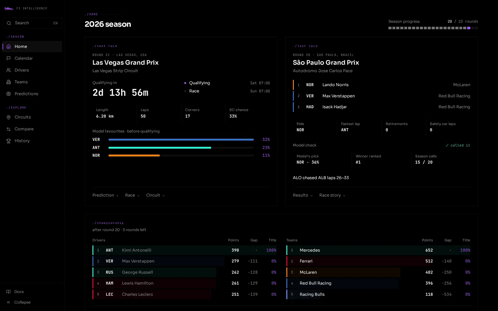
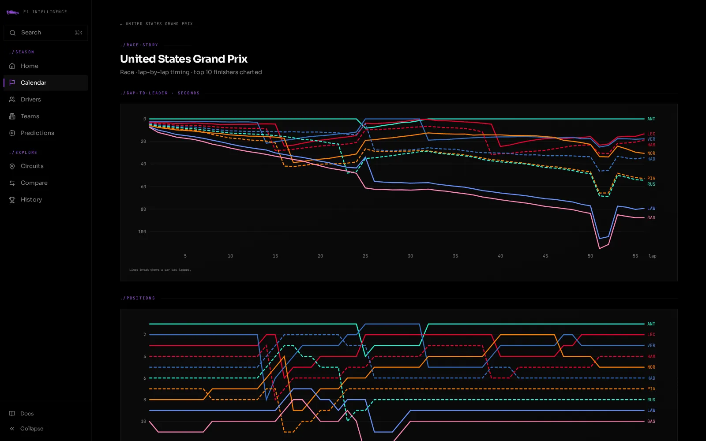
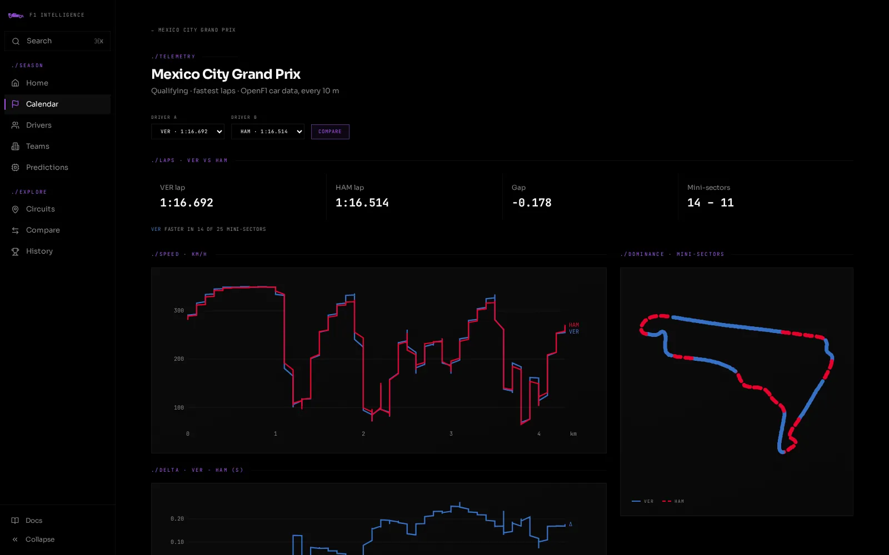
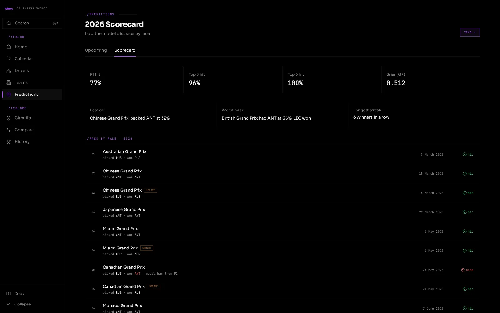
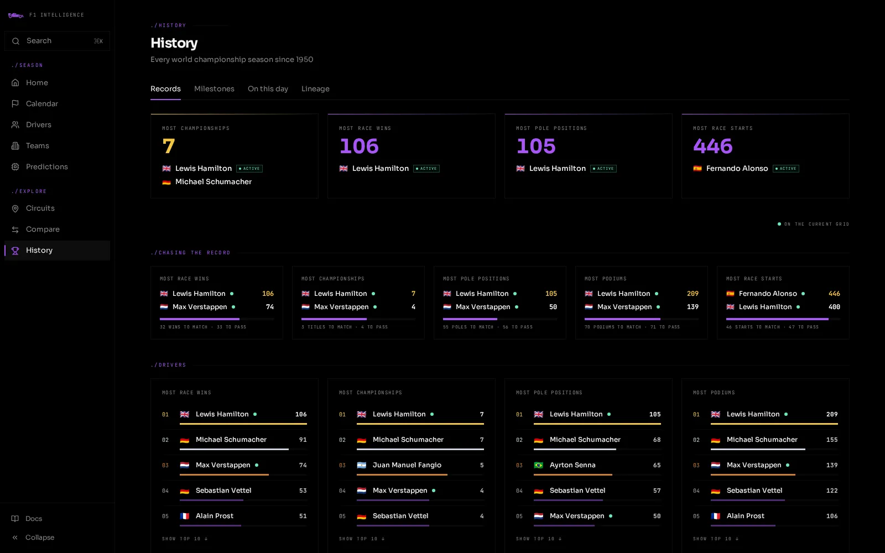
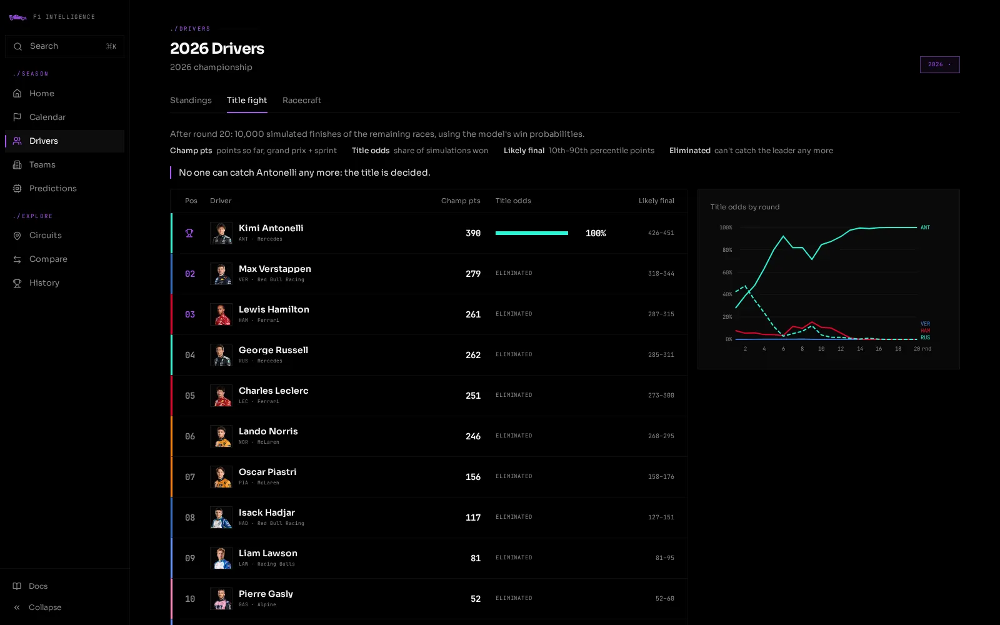

<div align="center">

# F1 Intelligence Platform

**Every race, explained. The next one, predicted.**

Race breakdowns, championship odds, history back to 1950 and a fitted model
that gives every driver a chance to win, before and after qualifying.

[**Open the site**](https://f1.gorkemkaryol.dev) ·
[How the model works](docs/prediction-model.md) ·
[Docs](https://f1.gorkemkaryol.dev/docs) ·
[Contributing](CONTRIBUTING.md) ·
[Report a bug](https://github.com/Glory42/F1-Intelligence-Platform/issues/new/choose)

[](https://github.com/Glory42/F1-Intelligence-Platform/actions/workflows/test.yml)
[](LICENSE)
[](docs/deployment.md)



</div>

## Features

- **Home**: where the season stands, the next race with a countdown and the model's top 3, the last race's podium and recap, and the title fight
- **Races**: results, qualifying, lap charts, practice long runs, tyre strategy, race control, overtakes and team radio
- **Race story**: gap to the leader, position changes, battles and weather, lap by lap from 2018 on
- **Telemetry**: two drivers' fastest qualifying laps side by side, with speed, delta and mini-sector dominance
- **Predictions**: a win chance for every driver at every GP and sprint, why the model picked its winner, and a season scorecard
- **Championship**: driver and constructor standings, title odds after every round and a what-if calculator
- **Circuits**: track maps, overtaking and safety car rates, past winners and a live weekend forecast
- **Compare**: any two drivers or teams, by season or across whole careers
- **History**: all-time records, milestones, on this day and constructor lineages back to 1950

## Screenshots

| Race story | Qualifying telemetry |
| --- | --- |
|  |  |
| **Prediction scorecard** | **Circuit** |
|  |  |
| **History** | **Title odds** |
|  |  |

More pages in [`preview/`](preview/).

## How the predictions work

Once qualifying is done, the model scores every driver on seven things it knows before the lights go out:
grid slot, how hard the track is to pass on, recent form, the team's race and qualifying pace, this
weekend's qualifying gap and the gap to the team-mate. The weights aren't hand-picked: they are fitted to
every Grand Prix since 2010, and a softmax turns the scores into a win chance for each driver.

Replayed race by race on 190 Grands Prix (2018–2026), using only what was known before each one, it picks
the winner **60%** of the time and has them in its top 3 **90%** of the time. Always backing the pole-sitter
gets 55%.

- **Sprints** use the same weights on the sprint grid
- **Before qualifying**, a forecast from form and team pace stands all week, and the page shows how qualifying moved each driver
- **Title odds** come from 10,000 simulated rest-of-seasons after every round

Everything else (features, backtests, the models it replaced): [docs/prediction-model.md](docs/prediction-model.md).

## Data

Live sessions come from [OpenF1](https://openf1.org) and [Jolpica](https://github.com/jolpica/jolpica-f1),
both free with no account. All-time history comes from [F1DB](https://github.com/f1db/f1db) (CC-BY-4.0),
weekend forecasts from [Open-Meteo](https://open-meteo.com). Race results go back to 1980, lap-level data to 2018.
What comes from where, and how far back: [docs/data-sources.md](docs/data-sources.md).

## Tech stack

| | |
| --- | --- |
| **Frontend** | Astro (server-rendered) and Tailwind on Cloudflare Pages; plain SVG charts |
| **API** | Hono and Drizzle ORM on Cloudflare Workers, cached at the edge |
| **Data engine** | Python 3.12 ETL worker on Render: ingest, features, predictions, title odds |
| **Database** | Neon PostgreSQL |
| **Hosting cost** | $0: every layer runs on a free tier and is built to stay inside it |

## Running locally

You need [Bun](https://bun.sh), Python 3.12 and Docker. Local dev runs against a local Postgres
snapshot, never the production database:

```bash
git clone https://github.com/Glory42/F1-Intelligence-Platform.git
cd F1-Intelligence-Platform
bun run install:all
bun run dev   # API on :8787, site on :4321
```

Filling the local database, the data engine, tests and checks: [CONTRIBUTING.md](CONTRIBUTING.md#local-setup).

## Project layout

```text
apps/
├── web/        Astro site
├── api/        Hono API, Drizzle schema and migrations
├── e2e/        Playwright smoke tests
└── og/         Share-image renderer
data-engine/    Python ETL worker, backfills, backtest and model fit
docs/           Architecture, pipeline, schema, model, API, deployment
```

## Documentation

| Read this | For |
| --- | --- |
| [CONTRIBUTING.md](CONTRIBUTING.md) | Setup, tests, conventions, the rules every change follows |
| [docs/architecture.md](docs/architecture.md) | How the site, API, data engine and database fit together |
| [docs/data-sources.md](docs/data-sources.md) | Where the data comes from and what each era has |
| [docs/data-pipeline.md](docs/data-pipeline.md) | Every ETL job, the race-weekend schedule, backfills |
| [docs/prediction-model.md](docs/prediction-model.md) | Features, fitted weights, backtests, title odds |
| [docs/api-reference.md](docs/api-reference.md) | Every API route and its response |
| [docs/database-schema.md](docs/database-schema.md) | Tables, keys and conventions |
| [docs/frontend.md](docs/frontend.md) | Pages, components and the server-only data rule |
| [docs/testing.md](docs/testing.md) | The five test suites and how CI runs them |
| [docs/deployment.md](docs/deployment.md) | Cloudflare, Render, environment variables, free-tier limits |
| [CODEMAP.md](CODEMAP.md) | File-by-file map of the repo |
| [CONTEXT.md](CONTEXT.md) and [docs/adr](docs/adr) | Domain language and architecture decisions |

App-level guides: [apps/api](apps/api/README.md) · [apps/web](apps/web/README.md) · [data-engine](data-engine/README.md).

## Contributing

Issues and pull requests are welcome: start with [CONTRIBUTING.md](CONTRIBUTING.md).
Wrong data on a page? Use the [data issue](https://github.com/Glory42/F1-Intelligence-Platform/issues/new/choose) template.
By taking part you agree to the [Code of Conduct](CODE_OF_CONDUCT.md). Please report security issues
privately as described in [SECURITY.md](SECURITY.md).

## License

[GPL-3.0](LICENSE). Historical data from [F1DB](https://github.com/f1db/f1db) under CC-BY-4.0.
This is an unofficial fan project and isn't associated with the Formula 1 companies. F1, FORMULA ONE and
related marks are trademarks of Formula One Licensing B.V.
