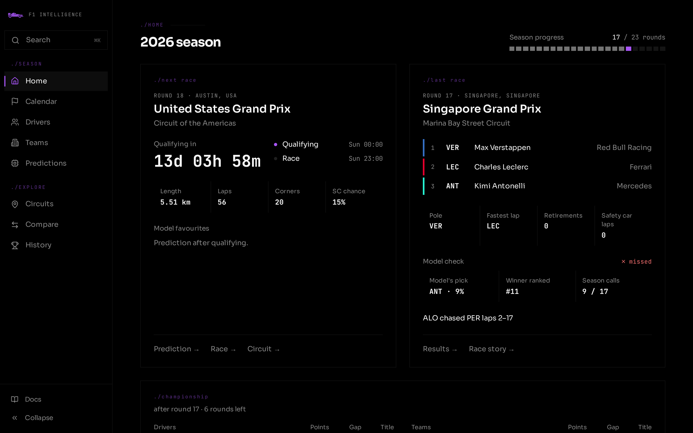

# [F1 Prediction Platform](https://f1.gorkemkaryol.dev/)



F1 race analysis and winner prediction built on FastF1, OpenF1 and F1DB. A weighted 12-feature model (8 for sprints) with softmax gives every driver a win probability after qualifying, and a Monte Carlo simulation turns those into championship odds after each round.

- **Races:** results, qualifying, lap chart, tyre strategy, race control, overtakes and team radio, plus a race story (gap to leader, positions, battles, weather) and a two-lap qualifying telemetry comparison, all from 2018 on
- **Championship:** driver and constructor standings, title odds by round, racecraft and pit crew rankings
- **Predictions:** the upcoming GP and sprint picks, a per-race breakdown of why the model picked its winner, and a season scorecard
- **Circuits:** track maps, overtake rates, safety car likelihood, winners, dominance and a live weekend forecast
- **Compare:** driver vs driver and team vs team, by season or career
- **History:** all-time records, milestones, on this day and constructor lineages since 1950 (F1DB)

Results data covers 1980–2026.

## Stack

| Layer | Technology | Host |
|-------|-----------|------|
| Frontend | Astro SSR + Tailwind | Cloudflare Pages |
| API | Hono + Drizzle ORM | Cloudflare Workers |
| Database | Neon PostgreSQL | Neon |
| Data Engine | Python + FastF1 | Render |

## Monorepo Layout

```
f1-prediction/
├── apps/
│   ├── web/       # Astro SSR (output: 'server', Cloudflare adapter)
│   │   └── src/     # pages/, features/, components/, lib/, types/
│   ├── api/       # Hono on Cloudflare Workers (NestJS-style modules)
│   │   ├── drizzle/migrations/  # Generated SQL migrations
│   │   └── src/
│   │       ├── db/schema/   # Drizzle table definitions (source of truth)
│   │       ├── common/      # code shared by several modules
│   │       └── modules/     # races, circuits, race-events, strategy, race-story, telemetry,
│   │                        # drivers, teams, predictions, sprint, history, seasons, search
│   └── e2e/       # Playwright smoke tests against a fixture API
├── data-engine/   # Python ETL worker on Render
│   ├── src/jobs/  # sync, ingest, compute jobs
│   └── scripts/   # local-only backfills and the F1DB import
└── docs/          # Architecture, API reference, schema, pipeline, deployment
```

See [CODEMAP.md](./CODEMAP.md) for the full file-level reference and [docs/adr/](./docs/adr/) for architectural rationale.

## Local Development

### Root (apps/api + apps/web)
```bash
bun run install:all
bun run dev         # runs api + web dev servers concurrently
```

### API (Hono: Cloudflare Workers)
```bash
cd apps/api
bun install
bun run dev        # wrangler dev on :8787
```

### Frontend (Astro)
```bash
cd apps/web
bun install
bun run dev        # Astro dev server on :4321
```

### Data Engine (Python)
```bash
cd data-engine
python -m venv venv
source venv/bin/activate
pip install -r requirements.txt
cp .env.example .env   # fill in DATABASE_URL
```

### Database (Drizzle)
```bash
cd apps/api
bunx drizzle-kit push   # apply schema to Neon
```

## ETL Jobs

```bash
cd data-engine
# First-time setup for a season
python -m src.main --job sync_schedule --year 2025
python -m src.main --job sync_season   --year 2025 --round 1

# Weekly pipeline
python -m src.main --job ingest_qualifying   --year 2025 --round 14
python -m src.main --job compute_features    --race_id 42
python -m src.main --job compute_predictions --race_id 42
python -m src.main --job ingest_race         --year 2025 --round 14
python -m src.main --job compute_season_stats --year 2025
```

Backfills run locally in bounded chunks, never on Render:
```bash
cd data-engine
python scripts/backfill_full.py --start 2018                 # results, laps, features, predictions
python scripts/backfill_openf1.py ingest_stints 2023 2026    # OpenF1 events (2023+)
python scripts/backfill_fastf1_enrichment.py 2018 2022       # stints, pit stops, race control, telemetry before OpenF1
python scripts/backfill_race_story.py 2018 2026              # race story charts
python scripts/backfill_title_odds.py 2018 2026              # title odds after every round
python scripts/import_f1db.py                                # all-time history (also a weekly GitHub Action)
```

See [docs/data-pipeline.md](./docs/data-pipeline.md) for every job and script.

## Environment Variables

| Variable | Service | How to set |
|----------|---------|-----------|
| `DATABASE_URL` | API (Worker) | Cloudflare Workers dashboard → Variables and Secrets → **Secret** |
| `DATABASE_URL` | Data Engine | Render dashboard → Environment Variables |
| `PUBLIC_API_URL` | Frontend | Cloudflare Pages dashboard → Environment Variables |

## Prediction Model

12 features, softmax with temperature T=0.3:

| Feature | Weight |
|---------|--------|
| Car Performance | 20% |
| Long Run Pace | 15% |
| Tyre Degradation | 8% |
| Reliability | 8% |
| Qualifying Delta | 8% |
| Driver Rating | 8% |
| Win Rate | 8% |
| Luck Factor | 7% |
| Circuit-Adj. Starting Position | 7% |
| Sector Strength | 6% |
| Circuit-Adj. Position Gain | 3% |
| Weather Impact | 2% |

See [docs/prediction-model.md](./docs/prediction-model.md) for full details.

## Deployment

- **API**: push to GitHub → Cloudflare Workers auto-deploys
- **Frontend**: push to GitHub → Cloudflare Pages auto-deploys
- **Data Engine**: Render Web Service: runs the pipeline every 20 min during a race weekend, every 6 h otherwise
- **F1DB history**: weekly GitHub Action (`.github/workflows/f1db-import.yml`, needs the `DATABASE_URL` repo secret)
