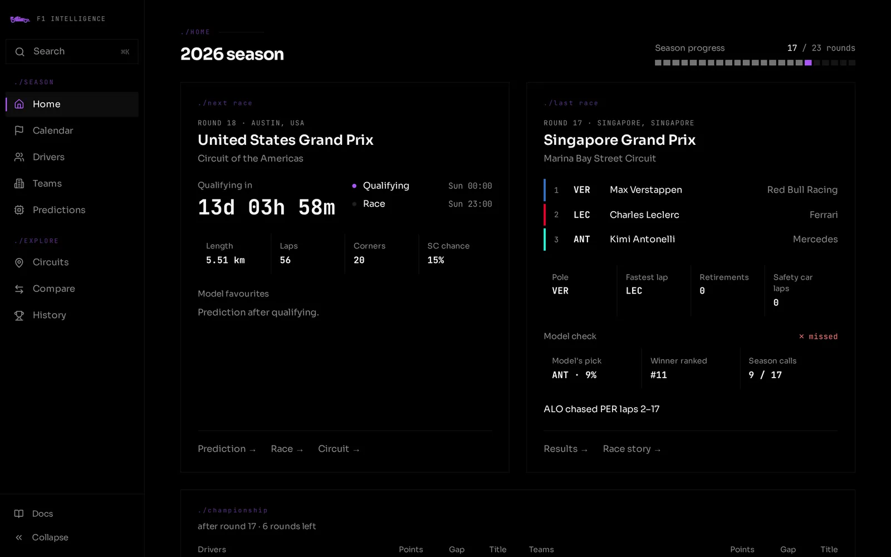

# [F1 Intelligence Platform](https://f1.gorkemkaryol.dev/)



An F1 analysis platform: race breakdowns, championship odds, all-time history and race-winner
predictions, built on OpenF1, Jolpica and F1DB. A conditional logit with 7 fitted features (a hand-weighted 8-feature model for sprints) gives every driver a win probability after qualifying, and a Monte Carlo simulation turns those into championship odds after each round.

- **Home:** season progress, the next race (schedule, circuit, model top 3), the last race's podium and recap, and the championship top 5 with title odds
- **Races:** results, qualifying, lap chart, practice long runs, tyre strategy, race control, overtakes and team radio, plus a race story (gap to leader, positions, battles, weather) and a two-lap qualifying telemetry comparison, all from 2018 on
- **Championship:** driver and constructor standings, title odds by round, racecraft and pit crew rankings
- **Predictions:** the upcoming GP and sprint picks, a per-race breakdown of why the model picked its winner, and a season scorecard
- **Circuits:** track maps, overtake rates, safety car likelihood, winners, dominance and a live weekend forecast
- **Compare:** driver vs driver and team vs team, by season or career
- **History:** all-time records, milestones, on this day and constructor lineages since 1950 (F1DB)

Results data covers 1980–2026.

Live data comes from OpenF1 and Jolpica, which are free and need no account. FastF1 used to be the
live source, but since FastF1 3.9 (October 2026) its timing data needs a paid F1TV subscription, and this
project pays for nothing. Why a login is a bad fit here: [ADR 0011](./docs/adr/0011-live-ingest-reads-openf1-and-jolpica.md).

## Stack

| Layer | Technology | Host |
|-------|-----------|------|
| Frontend | Astro SSR + Tailwind | Cloudflare Pages |
| API | Hono + Drizzle ORM (Neon HTTP driver) | Cloudflare Workers |
| Cache | Edge cache for API answers and rendered pages | Cloudflare |
| Database | Neon PostgreSQL | Neon |
| Data Engine | Python 3.12 + OpenF1 + Jolpica (FastF1 for the schedule and pre-2023 backfills) | Render |
| History | F1DB (CC-BY-4.0), imported weekly | GitHub Actions |

Everything runs on free tiers, and the project is built to stay inside them (Neon Free's compute and
egress, Render Free's 512 MB and 750 h). The rules and numbers: [roadmap §1–§2](./docs/plans/intelligence-platform-roadmap.md).

## Monorepo Layout

```
f1-intelligence/
├── apps/
│   ├── web/       # Astro SSR (output: 'server', Cloudflare adapter)
│   │   └── src/     # pages/, features/, components/, lib/, types/
│   ├── api/       # Hono on Cloudflare Workers (NestJS-style modules)
│   │   ├── drizzle/migrations/  # Generated SQL migrations
│   │   └── src/
│   │       ├── db/schema/   # Drizzle table definitions (source of truth)
│   │       ├── common/      # code shared by several modules
│   │       └── modules/     # races, circuits, race-events, strategy, race-story, telemetry,
│   │                        # drivers, teams, predictions, sprint, history, seasons, search, quality
│   └── e2e/       # Playwright smoke tests against a fixture API
├── data-engine/   # Python ETL worker on Render
│   ├── src/jobs/  # sync, ingest, compute jobs (one registry: src/jobs/registry.py)
│   ├── tests/     # pytest
│   └── scripts/   # local-only backfills, backtest, model fit and the F1DB import
└── docs/          # Architecture, API reference, schema, pipeline, deployment, ADRs
```

See [CODEMAP.md](./CODEMAP.md) for the full file-level reference, [CONTEXT.md](./CONTEXT.md) for the
domain vocabulary and [docs/adr/](./docs/adr/) for architectural rationale.

## Local Development

Local dev never touches Neon: every wake bills Neon Free at least 5 minutes. It runs against a local
Postgres (`docker-compose.dev.yml`, behind the same Neon HTTP proxy the tests use), filled once by a
read-only dump:

```bash
cd data-engine
PROD_DATABASE_URL=postgresql://...neon.tech/... python scripts/dev_snapshot.py   # starts the containers too
```

Then point `apps/api/.dev.vars` at it (`DATABASE_URL=postgres://f1:f1@localhost:4446/f1_dev` and
`NEON_FETCH_ENDPOINT=http://localhost:4446/sql`) and `data-engine/.env` at
`postgresql://f1:f1@localhost:5435/f1_dev`. Rerun the snapshot only when you want newer races.
Scripts that must write production take `DATABASE_URL=$PROD_DATABASE_URL` explicitly.

### Root (apps/api + apps/web)
```bash
bun run install:all
bun run dev         # runs api + web dev servers concurrently
```

### API (Hono: Cloudflare Workers)
```bash
cd apps/api
bun install
bun run dev        # wrangler dev on :8787
```

### Frontend (Astro)
```bash
cd apps/web
bun install
bun run dev        # Astro dev server on :4321
```

### Data Engine (Python)
```bash
cd data-engine
python -m venv venv
source venv/bin/activate
pip install -r requirements.txt
cp .env.example .env   # points at the local snapshot by default
```

### Database (Drizzle)
The schema lives in `apps/api/src/db/schema/` and its migrations in `apps/api/drizzle/migrations/`.
```bash
cd apps/api
bun run db:generate   # SQL migration from a schema change
bun run db:migrate    # apply the migration files
```

## Tests

None of them touch Neon. See [docs/testing.md](./docs/testing.md).

```bash
cd apps/api && bun run test:unit                                # bun test
cd apps/api && bun run test:db:up && bun run test:integration   # real routes against a local Postgres
cd apps/web && bun run test                                     # Vitest + MSW
cd apps/e2e && bun run test                                     # Playwright smoke tests against a fixture API
cd data-engine && pytest                                        # pure functions + a fake DB double
```

## ETL Jobs

```bash
cd data-engine
# First-time setup for a season
python -m src.main --job sync_schedule --year 2025
python -m src.main --job sync_season   --year 2025 --round 1

# Weekly pipeline
python -m src.main --job ingest_qualifying   --year 2025 --round 14
python -m src.main --job compute_features    --race_id 42
python -m src.main --job ingest_race         --year 2025 --round 14
python -m src.main --job compute_season_stats --year 2025
```

Backfills run locally in bounded chunks, never on Render:
```bash
cd data-engine
python scripts/backfill_full.py --start 2023                 # results, laps, features, predictions (OpenF1 has 2023+)
python scripts/backfill_openf1.py ingest_stints 2023 2026    # OpenF1 events (2023+)
python scripts/backfill_fastf1_enrichment.py 2018 2022       # stints, pit stops, race control, telemetry before OpenF1
python scripts/backfill_race_story.py 2018 2022              # race story charts (FastF1 cache seasons)
python scripts/backfill_title_odds.py 2018 2026              # title odds after every round
python scripts/import_f1db.py                                # all-time history (also a weekly GitHub Action)
python scripts/neon_usage.py                                 # Neon Free usage + month-end projection (no DB wake)
```

Model work runs against its own local snapshot (`scripts/backtest_snapshot.py`):
```bash
python scripts/backtest.py --from 2018      # walk-forward GP model vs baselines
python scripts/fit_model_v4.py              # refit src/models/gp_v4.json, only after the backtest validates a change
```

See [docs/data-pipeline.md](./docs/data-pipeline.md) for every job and script.

## Environment Variables

| Variable | Service | How to set |
|----------|---------|-----------|
| `DATABASE_URL` | API (Worker) | Cloudflare Workers dashboard → Variables and Secrets → **Secret** |
| `DATABASE_URL`, `DASHBOARD_PASSWORD` | Data Engine | Render dashboard → Environment Variables |
| `NEON_API_KEY`, `NEON_PROJECT_ID` | Data Engine | Budget watchdog: logs a failure when Neon Free usage passes, or is on pace to pass, the budget |
| `PUBLIC_API_URL` | Frontend | Cloudflare Pages dashboard → Environment Variables |

The full list for the Render service is in `data-engine/render.yaml`; setup steps in [docs/deployment.md](./docs/deployment.md).

## Prediction Model

GP model `weighted-v4`: a conditional logit (softmax, T=1) over 7 features, with weights fitted to every
GP since 2010 by `scripts/fit_model_v4.py`. Importance is each feature's share of the fitted weight per SD:

| Feature | Importance |
|---------|------------|
| Grid Slot | 20% |
| Driver Form | 18% |
| Team Race Pace | 18% |
| Grid × Hard-to-Pass Track | 17% |
| Team Qualifying Pace | 12% |
| Qualifying Pace | 11% |
| Teammate Edge | 4% |

The sprint model (`sprint-v2`) keeps 8 hand-picked weights and softmax T=0.3.

See [docs/prediction-model.md](./docs/prediction-model.md) for full details.

## Deployment

Never deploy from the CLI: push to `master` and let the integrations deploy.

- **API**: Cloudflare Workers, on `f1-api.gorkemkaryol.dev` (the edge cache needs a custom domain) and `*.workers.dev`
- **Frontend**: Cloudflare Pages, on `f1.gorkemkaryol.dev`
- **Data Engine**: Render Web Service running one worker loop (`src/server.py`): every 20 min inside a race-weekend window, every 6 h outside it. `src/weekend_pipeline.py` decides which jobs are due from each race's status
- **F1DB history**: weekly GitHub Action (`.github/workflows/f1db-import.yml`, needs the `DATABASE_URL` repo secret)
