# Architecture

## Monorepo Layout

```
f1-intelligence/
├── apps/
│   ├── web/       Astro SSR frontend: Cloudflare Pages
│   ├── api/       Hono REST API: Cloudflare Workers
│   └── e2e/       Playwright smoke tests against a fixture API
└── data-engine/   Python ETL worker: Render
```

The schema source of truth lives in `apps/api/src/db/schema/`. Generated SQL migration files live in
`apps/api/drizzle/migrations/`: both are owned by `apps/api/`, not a separate top-level package.

---

## How the Four Layers Connect

```
┌─────────────────────────────────────────────────┐
│  Browser                                        │
└────────────────────┬────────────────────────────┘
                     │ HTTPS
┌────────────────────▼────────────────────────────┐
│  apps/web/  (Astro SSR: Cloudflare Pages)      │
│  Renders HTML server-side, fetches from API     │
│  in Astro frontmatter (never client-side JS)    │
└────────────────────┬────────────────────────────┘
                     │ HTTP (PUBLIC_API_URL)
┌────────────────────▼────────────────────────────┐
│  apps/api/  (Hono: Cloudflare Workers)         │
│  Read-only REST API, Drizzle ORM queries        │
│  Uses @neondatabase/serverless (HTTP driver)    │
│  Edge cache (Cloudflare Cache API)              │
└────────────────────┬────────────────────────────┘
                     │ Neon HTTP
┌────────────────────▼────────────────────────────┐
│  Neon PostgreSQL                                │
│  Shared DB: written by data-engine,            │
│  read by api                                    │
└────────────────────▲────────────────────────────┘
                     │ psycopg2 TCP
┌────────────────────┴────────────────────────────┐
│  data-engine/  (Python: Render Web Service)    │
│  Fetches F1 data via OpenF1 + Jolpica, computes │
│  features and predictions, writes to DB         │
└─────────────────────────────────────────────────┘
```

---

## Key Constraints

**Cloudflare Workers have no TCP.** The `apps/api/` layer must use `@neondatabase/serverless` (HTTP driver). Never use `pg` or `postgres` packages there.

**Python writes directly to Neon.** The API is read-only. There are no write endpoints: the ETL engine connects directly via psycopg2. Fresh data reaches the site once the edge cache's `max-age` lapses (10 min on race weekends, 1 h between).

**All data fetching in Astro frontmatter.** No client-side data fetching, no React/Vue islands for data. The `---` blocks handle everything server-side. The only exceptions are `GlobalSearch`, `DriverCompareTool` and `TeamCompareTool`, whose data depends on arbitrary user input (see [Frontend](./frontend.md)).

**Stay inside the free tiers.** Neon Free, Render Free and Cloudflare's free plan; local dev and tests never touch Neon. Rules and numbers: `docs/plans/intelligence-platform-roadmap.md` §1–§2.

---

## Data Flow: Conventional Weekend

```
Saturday
  data-engine: ingest_qualifying   → qualifying_results table
  data-engine: ingest_fp2          → fp2_long_run_times table
  data-engine: compute_features    → driver_prediction_features + race_predictions (one transaction)
  data-engine: compute_title_odds  → title_odds_drivers + title_odds_teams (optional step)
  data-engine: ingest_qualifying_telemetry → qualifying_lap_telemetry (optional step)
  race.status: scheduled → qualifying_done

Sunday
  data-engine: ingest_race         → race_results + lap_times tables
  data-engine: compute_season_stats→ driver_season_stats + team_season_stats
  data-engine: compute_title_odds  → title_odds_drivers + title_odds_teams
  data-engine: race events (optional, once past OpenF1's live window)
               ingest_race_control / ingest_overtakes / ingest_team_radio / ingest_stints / ingest_pit_stops
  race.status: qualifying_done → completed
```

## Data Flow: Sprint Weekend

```
Friday
  data-engine: ingest_sprint_qualifying → sprint_results (SQ grid + sq1/sq2/sq3 times)
  data-engine: compute_sprint_features  → driver_sprint_features + sprint_predictions
  race.status: scheduled → sprint_qualifying_done

Saturday
  data-engine: ingest_sprint        → sprint_results (finish positions), sprint_lap_times,
                                      races (sprint_weather, sprint_safety_car_laps, etc.)
  data-engine: compute_season_stats → updates sprint aggregates in driver_season_stats
  race.status: sprint_qualifying_done → sprint_done

  data-engine: ingest_qualifying    → qualifying_results
  data-engine: ingest_fp2           → fp2_long_run_times
  data-engine: compute_features     → driver_prediction_features + race_predictions
  race.status: sprint_done → qualifying_done

Sunday
  data-engine: ingest_race          → race_results + lap_times
  data-engine: compute_season_stats → final season stats
  race.status: qualifying_done → completed
```

---

## Screenshots

**Home**

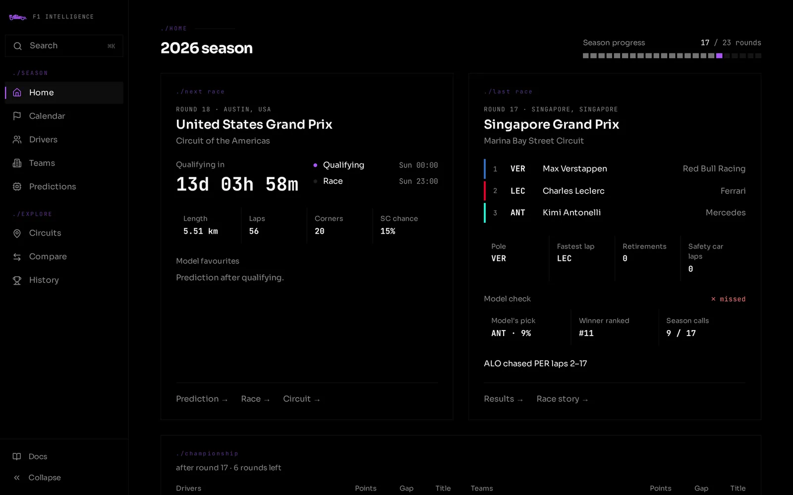

**Races calendar**

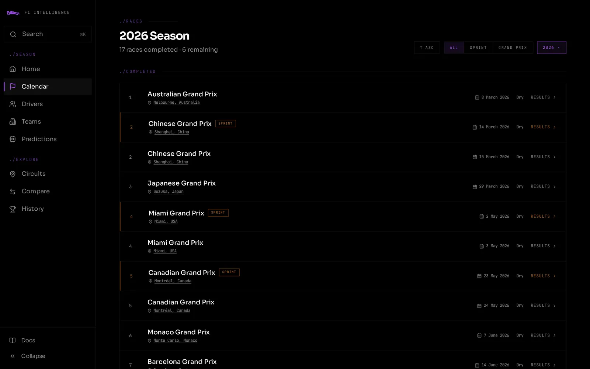

**Race detail**

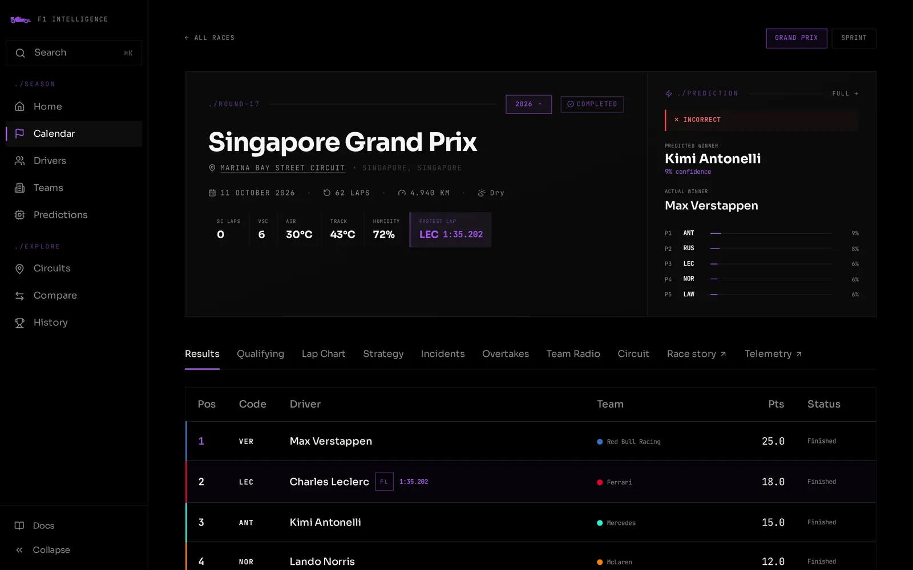

**Race story: gap to leader and positions, lap by lap**

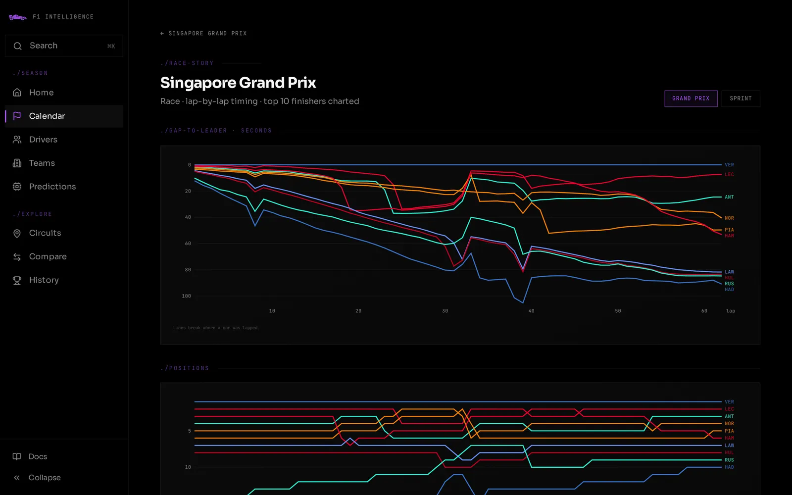

**Qualifying telemetry: two fastest laps compared**

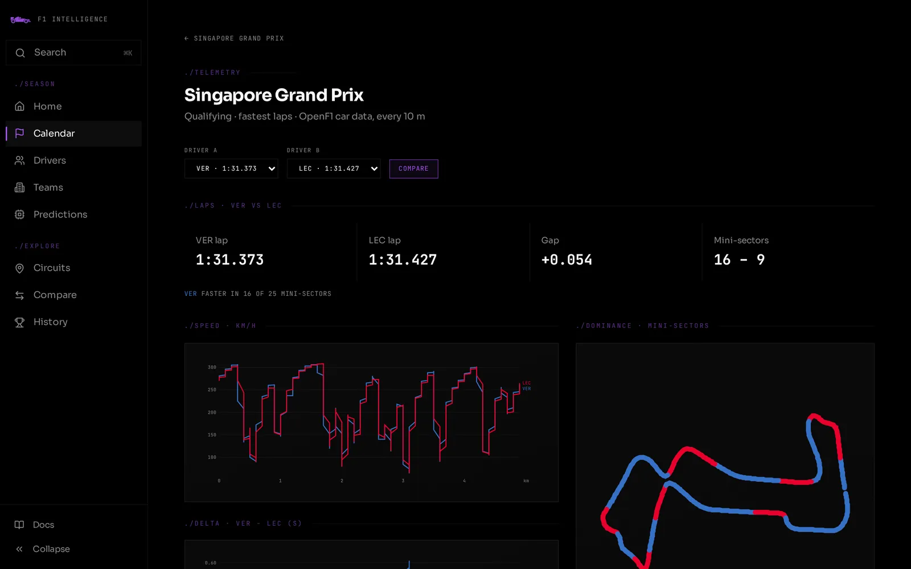

**Driver standings**

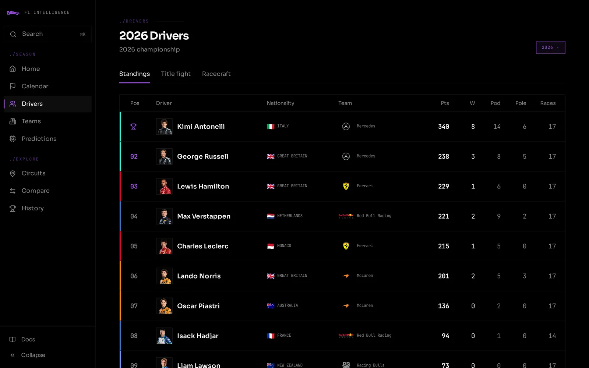

**Driver detail**

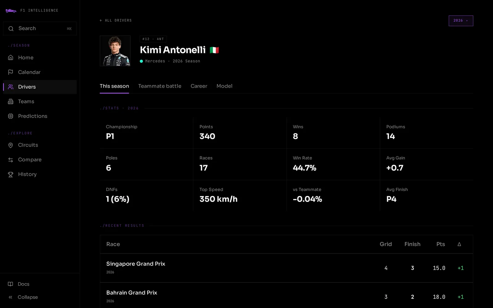

**Constructors: pit crew rankings**

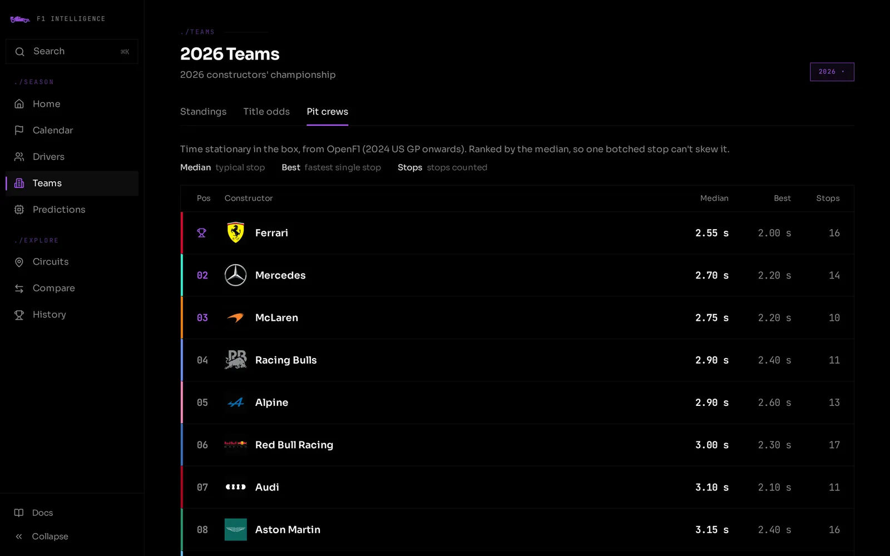

**Constructor detail**

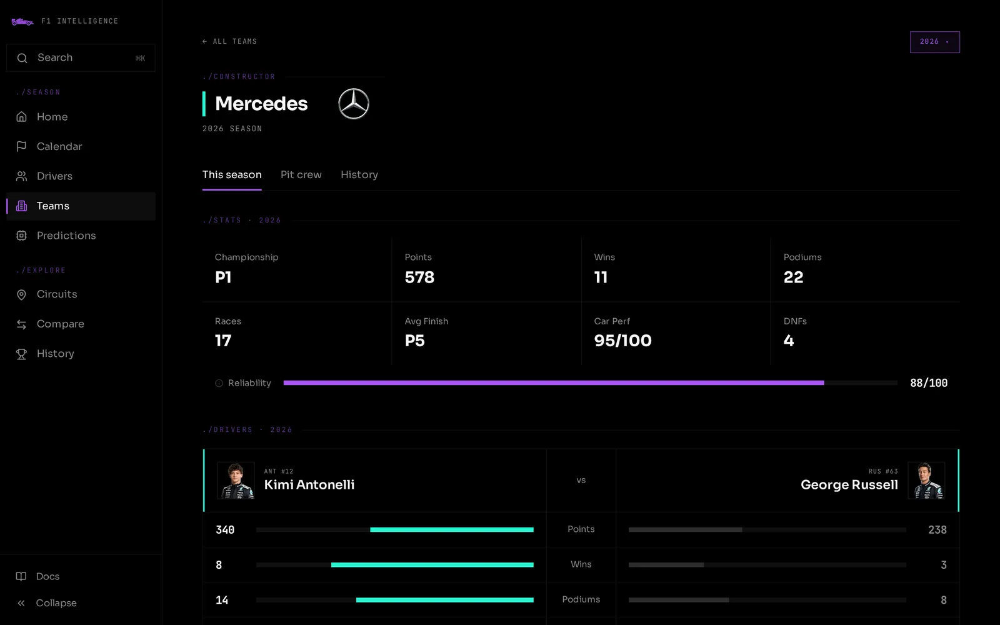

**Circuits directory**

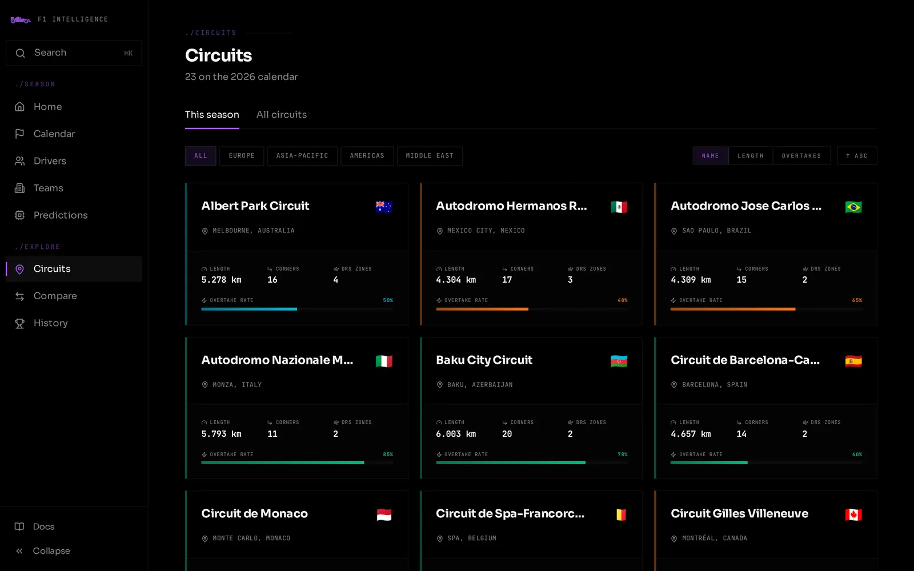

**Circuit detail**

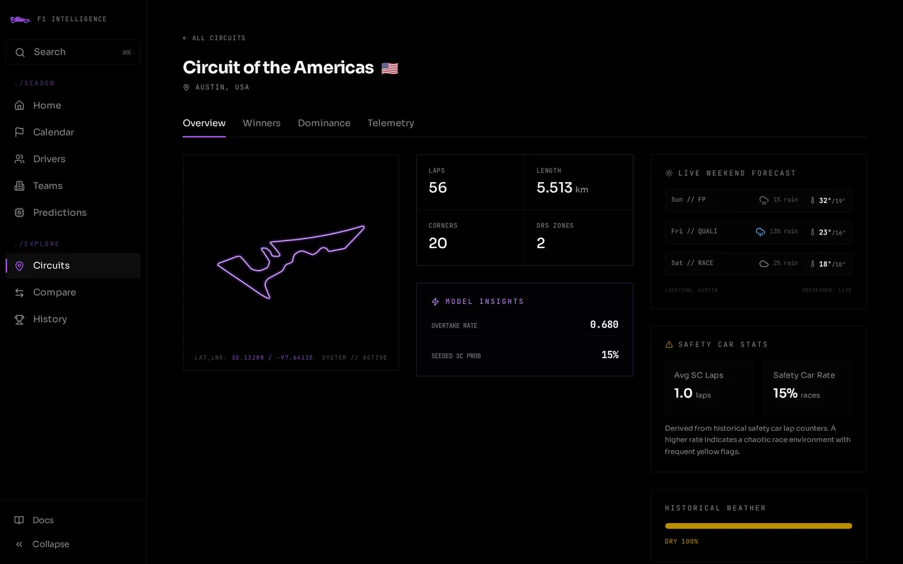

**Driver comparison tool**

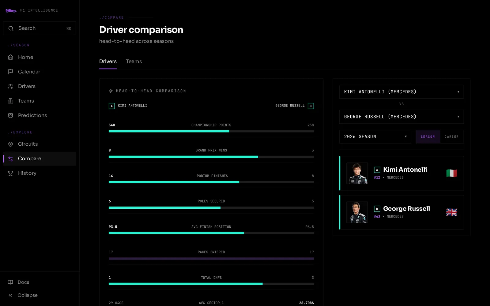

**Team comparison tool**

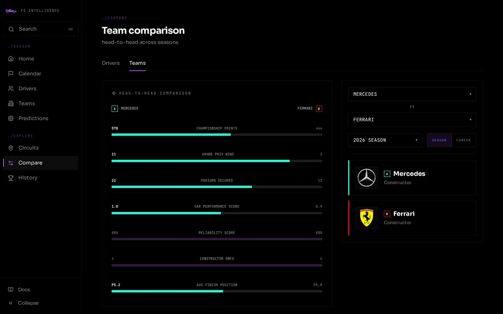

**All-time history (F1DB)**

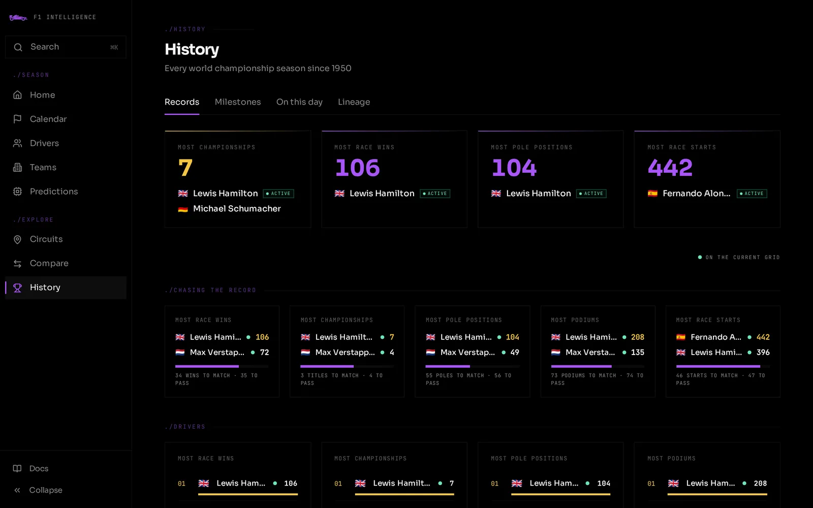

---

## Deployment

| Layer | Host | Trigger |
|-------|------|---------|
| `apps/web/` | Cloudflare Pages | Push to `master` → GitHub integration auto-deploys |
| `apps/api/` | Cloudflare Workers | Push to `master` → GitHub integration auto-deploys |
| `data-engine/` | Render | Web Service running one worker loop: every 20 min inside a race-weekend window, every 6 h outside it |
| DB migrations | Neon | Manual: `bun run db:generate` + `bun run db:migrate` from `apps/api/` |
