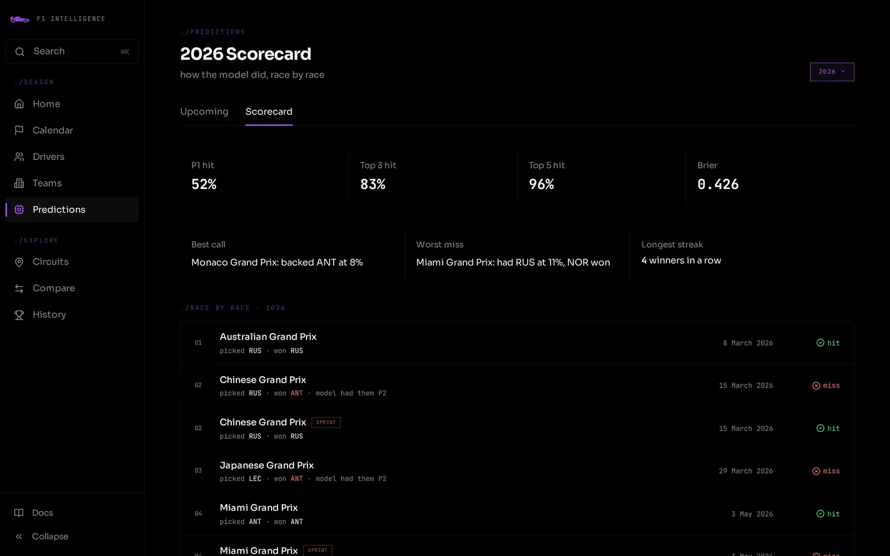
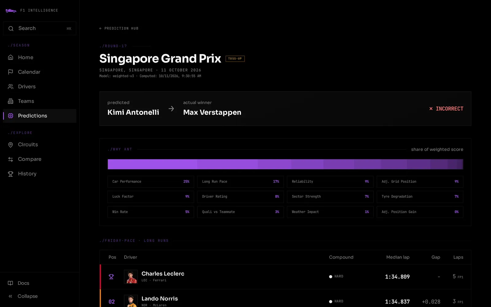
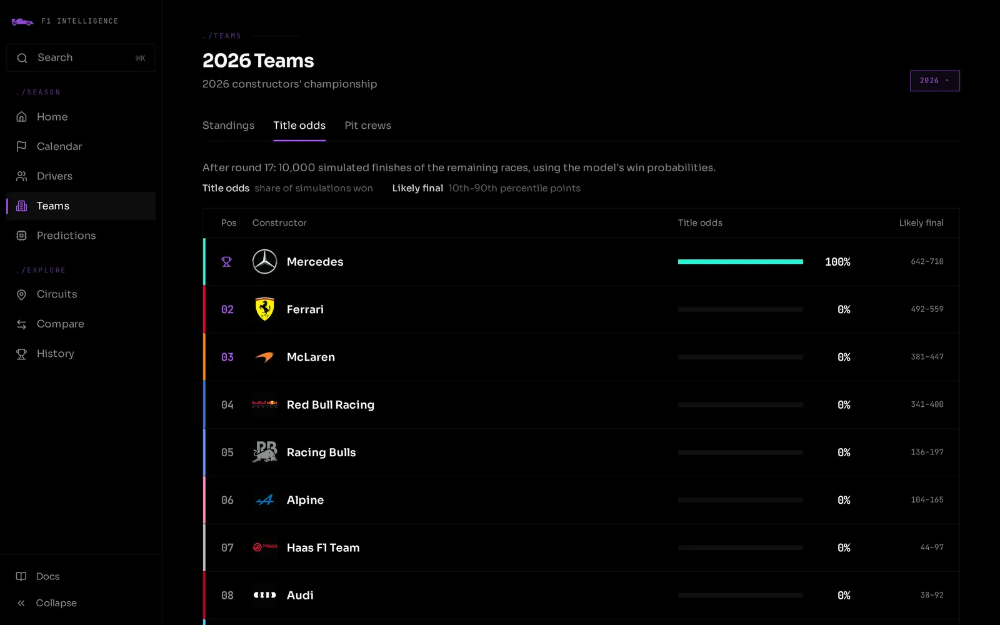

# Prediction Model

## Overview

Two separate models run per race weekend: one for the grand prix, one for the sprint (sprint weekends only). Both score each driver with a weighted sum of features and turn the field's scores into win probabilities with a softmax. The grand prix model (`weighted-v4`) has its weights fitted to every GP since 2010; the sprint model (`sprint-v2`) keeps hand-picked weights, since about 30 sprints are too few to fit (ADR 0010).

**Prediction scorecard**



**Race prediction detail**



**Championship title odds**



---

## Where the data comes from

Every feature score ultimately originates from one of three places:

### 1. OpenF1 + Jolpica (session data, free APIs)
The Python ingest jobs read each finished session from OpenF1 (laps, sectors, tyres, weather,
race control, qualifying times) and the official race classification from Jolpica (grid,
status, points), then store them in raw tables (`utils/openf1_session.py`). This was FastF1
until October 2026, when FastF1 3.9 started requiring a paid F1TV subscription (ADR 0011).
Seasons ingested before then keep their FastF1 rows.

| Session | Ingest job | Populates table(s) |
|---------------|-----------|-------------------|
| Race (`'R'`) | `ingest_race` | `race_results`: finish pos, grid pos, status, points |
| Qualifying (`'Q'`) | `ingest_qualifying` | `qualifying_results`: Q1/Q2/Q3 lap times, grid pos, sector times |
| FP2 (`'FP2'`) | `ingest_fp2` | `fp2_long_run_times`: stint median lap times on each compound |
| Race lap data | `ingest_race` | `lap_times`: per-lap time, sector times, tyre compound, tyre life, speed |
| Sprint (`'S'`) | `ingest_sprint` | `sprint_results`: sprint finish pos, points |
| Sprint Qualifying (`'SQ'`) | `ingest_sprint_qualifying` | `sprint_results.sq1/sq2/sq3_time_ms` |
| Sprint lap data | `ingest_sprint` | `sprint_lap_times`: per-lap sprint data |
| Weather | every ingest | `races.weather`, `races.sprint_weather`: share of OpenF1 weather samples with rain |

OpenF1's `headshot_url` is used for driver photos (FastF1's before 2023; not available before 2019).
Neither source provides team logos: those are stored as static files in `apps/web/public/teams/`.

### 2. Computed aggregates (run after each race)
`compute_season_stats` reads from the raw tables above and computes season-wide summaries for the
standings pages. The sprint features read the same aggregates computed as of the race date
(`utils/season_aggregates.py`); weighted-v4 builds its own form features from an in-memory race history.

| Aggregate table | Computed from | Key columns used by features |
|----------------|--------------|------------------------------|
| `driver_season_stats` | `race_results`, `qualifying_results` | `total_points`, `wins`, `races_entered`, `dnf_rate`, `avg_position_gain`, `teammate_quali_delta` |
| `team_season_stats` | `race_results` | `car_performance_score` (normalized avg finish), `reliability_score` (1 − DNF rate) |

### 3. Static / hardcoded
Some inputs never change and are seeded once into the database or hardcoded in Python.

| Value | Where stored | Changes? |
|-------|-------------|---------|
| Circuit overtake rate | `circuits.overtake_rate` | Never: seeded once per track |
| Circuit SC probability | `circuits.sc_probability` | Never: seeded once per track |
| GP model weights | `data-engine/src/models/gp_v4.json` (fitted, written by `scripts/fit_model_v4.py`); importances + labels in `docs/feature-weights.json`, mirrored in `predictionMath.ts` `FEATURE_META` and the API's `GP_FEATURE_MANIFEST` | On a deliberate, backtested refit |
| Sprint model weights + labels | `feature_manifest.py` `SPRINT_FEATURES` (re-exported as `WEIGHTS` by `compute_sprint_features.py`); mirrored in `predictionMath.ts` `SPRINT_FEATURE_META` and the API's `SPRINT_FEATURE_MANIFEST`, same JSON check | Only when model is intentionally updated |
| Sprint softmax temperature T=0.3 | `feature_manifest.py` / `predictionMath.ts` `SPRINT_SOFTMAX_TEMPERATURE`, checked against `sprint_softmax_temperature` in `docs/feature-weights.json`. The GP model has none (T = 1) | Only when model is intentionally updated |

---

## Data pipeline: end-to-end flow

```
OpenF1 + Jolpica sessions (FastF1 before Oct 2026)
    │
    ▼  (ingest jobs)
raw tables: race_results, qualifying_results, lap_times, sprint_results,
            sprint_lap_times, fp2_long_run_times
    │
    ├──▶ GP: race_history (last 3 seasons, in memory) ─▶ gp_features_v4 ─▶ src/models/gp_v4.json weights
    │                                                     (compute_features)
    └──▶ sprint: season aggregates as of the race + sprint features (compute_sprint_features)
         │
         ▼
    driver_prediction_features (features JSONB) / driver_sprint_features (score columns)
         │
         ▼  (compute_predictions: softmax T = 1 / compute_sprint_predictions: T = 0.3)
    race_predictions / sprint_predictions
         │
         ▼  (Hono API reads)
    /prediction page: win probabilities, each driver's edge over the field, what-if lab
```

---

## Race Status Flow

```
conventional weekend:
  scheduled → qualifying_done → completed
                   │                │
          compute_features    ingest_race
          compute_predictions compute_season_stats

sprint weekend:
  scheduled → sprint_qualifying_done → sprint_done → qualifying_done → completed
                       │                   │               │
              compute_sprint_features  ingest_sprint  compute_features
              compute_sprint_predictions               compute_predictions
```

Main race predictions are computed at `qualifying_done`. Sprint predictions are computed at `sprint_qualifying_done` (after SQ session).

---

## Grand Prix Model: `weighted-v4`, 7 fitted features

See § Backtest below for the features, how they were chosen and how the model scores. In short: each
driver's score is Σ weight × standardized feature, the weights are fitted to past winners
(`utils/conditional_logit.py`, committed in `src/models/gp_v4.json`), and the stored row keeps every
feature's value and contribution (`features` JSONB). `raw_weighted_score` is the summed contributions.

## Sprint Model: `sprint-v2`, 8 Features

Intentionally different from the main race model. Sprint races are ~17 laps with no pit stops: track position and car dominance matter far more than long-run strategy or reliability.

| Feature | Weight | Source |
|---------|--------|--------|
| Car Performance | 25% | `team_season_stats.car_performance_score` |
| Circuit-Adj. Starting Position | 25% | Same multiplier as GP: `start_pos × (1 + (1−overtake_rate)) × (1 − 0.3×sc_prob)` |
| Short Run Pace | 10% | Best SQ lap time (sq1/sq2/sq3_time_ms); falls back to main qualifying if SQ not yet ingested |
| Driver Rating | 10% | Sprint-specific (`sprint_total_points / sprint_races / 8`) when ≥3 sprint races recorded; falls back to main race rating |
| Weather Impact | 8% | Cross-season historical wet performance. Always neutral (0.5) for now: `races.sprint_weather` is only written after the sprint |
| Win Rate | 8% | Sprint-specific when ≥3 sprint races recorded; falls back to main race win rate |
| Luck Factor | 8% | Rolling 5-race delta from recent grand prix results: cross-season |
| SQ vs Teammate | 6% | Recency-weighted (5→1) mean of SQ teammate gap across last 5 sprint weekends: cross-season |

### Weighted Score

`raw = weighted_sum(feature_values, WEIGHTS)`, same combination rule as the GP model. Sourced
from `feature_manifest.py`'s `SPRINT_FEATURES`: see the GP model's note above.

Sprint driver rating and win rate use sprint-specific history when ≥3 sprint races are recorded, otherwise fall back to main race stats (scaled to match the 8-point sprint maximum vs 25-point race maximum).

---

## Softmax → Win Probability

```python
exp_s = np.exp(scores / T)
win_probability = exp_s / exp_s.sum()
```

- **GP (weighted-v4): T = 1.** The fitted weights already set how decisive the model is, so there is no
  separate temperature to tune: the fit picks the scale that best matches who actually won.
- **Sprint (sprint-v2): T = 0.3**, `SPRINT_SOFTMAX_TEMPERATURE` in `feature_manifest.py` and
  `predictionMath.ts`. Its weights are hand-picked percentages, so it needs one.

Probabilities sum to 1.0 across all drivers in a race.

## Predicted Position

Drivers are ranked by `win_probability` descending. Rank 1 = predicted winner, stored in `race_predictions.predicted_winner_id` (or `sprint_predictions.predicted_winner_id` for sprints). All driver positions are stored in `driver_prediction_features.predicted_position` (or `driver_sprint_features.predicted_position`).

---

## Data Availability by Era

| Years | Qualifying data | Lap times | Sprint data |
|-------|----------------|-----------|-------------|
| 2018–present | Full Q1/Q2/Q3 + sector times | Full per-lap telemetry | Full SQ times + sprint lap times |
| 2006–2017 | Q1/Q2/Q3 times | None | N/A (sprint format started 2021) |
| 2000–2005 | Single best lap time only | None | N/A |
| 1990–1999 | None (fell back to race starting grid) | None | N/A |

For races without qualifying data, `compute_features` cannot run: those races have no predictions.


## Championship title odds (`title-odds-v1`)

`compute_title_odds` (data-engine) turns race-by-race win probabilities into championship odds:

1. **Remaining sessions**: every GP not yet `completed`, plus the sprint on sprint weekends whose
   status is `scheduled`/`sprint_qualifying_done` (`build_remaining_races`).
2. **Win probabilities per session**: the session's own stored prediction when it exists
   (features exist once qualifying is in); otherwise each driver's mean predicted GP win probability
   over the last 5 predicted races (`form_win_probs`), floored at 0.001 so no driver is impossible.
3. **Finishing orders**: Plackett–Luce draws via the Gumbel-max trick: sort `log(p) + Gumbel noise`.
   The winner follows `p`; lower places follow the same softmax ranking, so each session keeps its own
   model's temperature (T = 1 for the GP, 0.3 for the sprint).
4. **Points**: GP 25-18-15-12-10-8-6-4-2-1 (no fastest-lap point, as from 2025); sprint 8-7-…-1.
   Current points are `total_points + sprint_total_points`.
5. **Aggregate**: 10,000 seasons, seeded by `(year, after_round)` so reruns are identical. A points
   tie splits the title (countback isn't simulated). Team odds sum each team's drivers within the
   same simulated seasons, so driver and constructor odds are consistent.

The web standings additionally show pure mathematical contention (`titleContention` in
`apps/web/src/lib/f1/championshipMath.ts`): a driver is eliminated once their points plus every point
still available (26 per GP 2019–2024, 25 otherwise; 8 per sprint, 3 in 2021) fall short of the leader.


## Backtest (walk-forward, leakage-free)

`scripts/backtest.py` replays every completed GP from a local snapshot of Neon
(`scripts/backtest_snapshot.py` → `docker-compose.backtest.yml`; it refuses Neon itself). Each race is
predicted with the real feature job, which reads season stats as of the race date
(`utils/season_aggregates.py`), and scored with `utils/backtest.py`: log loss, multi-class Brier,
top-1/top-3 (tie-aware) and a calibration table. Baselines: `grid-history`, P(win | grid slot) learned only
from earlier races (its top pick is the pole-sitter), and `uniform`. New candidates are one entry in
`CANDIDATES`.

Before 2026-10-22 every recomputed past prediction read whole-season stats and the race's own weather, so
it partly knew the result. First honest run, 190 races 2018–2026:

| model | log loss | Brier | top-1 | top-3 |
|---|---|---|---|---|
| weighted-v3 (honest) | 2.446 | 0.879 | 43.2% | 75.8% |
| grid-history | 1.457 | 0.651 | 55.3% | 87.9% |
| uniform | 3.000 | 0.950 | 5.0% | 14.9% |
| weighted-v3 stored (leaky) | 2.361 | 0.867 | 48.4% | 81.6% |

v3 loses to "the pole-sitter wins" and is badly under-confident: its favourites get ~11% and win ~51% of
the time. v4 has to beat `grid-history`, not just v3.

### weighted-v4

A conditional logit (`utils/conditional_logit.py`): the same softmax over a weighted sum as v3, but the
weights are fitted to past winners by maximum likelihood (damped Newton, L2 on standardized features), so the
temperature is part of the fit. The backtest refits it before every race on earlier races only, from 2010.
Features (`utils/gp_features_v4.py`, from an in-memory `utils/race_history.py`) are in real units, not
per-race min-max, and form is a decayed average over each person's / outfit's last 12 races across seasons
(identity: `utils/identity.py`, mirroring the API's `identity.ts`):

| feature | meaning | weight per SD (fit on 2010–2026) |
|---|---|---|
| `grid` | −log(grid slot): pole vs P2 matters, P15 vs P16 barely | +0.64 |
| `grid_processional` | `grid` × (1 − circuit overtake rate) | +0.52 |
| `team_race_pace` | outfit's decayed gap to the fastest clean race-lap median (2018+ laps) | +0.57 |
| `driver_points` | decayed points per race, finish positions scored on the 2010+ table | +0.56 |
| `team_quali_pace` | outfit's decayed best qualifying gap to pole | +0.40 |
| `quali_pace` | this weekend's gap to the fastest time in the deepest session reached | +0.36 |
| `teammate_edge` | decayed qualifying gap to the team-mate | +0.14 |

Chosen on 2018–2021 and confirmed on 2022–2026. Also tried and left out, adding nothing beyond noise:
driver wins, team points, team DNF rate, practice long runs, this weekend's sprint result, the circuit's
safety-car rate; and stronger L2.

| model, 190 races 2018–2026 | log loss | Brier | top-1 | top-3 |
|---|---|---|---|---|
| weighted-v4 | 1.208 | 0.566 | 60.0% | 90.0% |
| v3 features, fitted weights | 1.457 | 0.668 | 48.4% | 87.4% |
| grid-history | 1.457 | 0.651 | 55.3% | 87.9% |
| weighted-v3 | 2.446 | 0.879 | 43.2% | 75.8% |

Paired against `grid-history`, v4's log loss is −0.249 ± 0.099 (2 SE). It is also calibrated: drivers given
10–20% win 12.5% of the time, 50–70% win 65%, 70%+ win 75%. (These baseline rows are from the run that
still included v3; the harness now seeds `grid-history` from 2007 on, which moves it to 1.453 / 55.3%.)

The predictions stored for 2018–2026 are fitted per season on earlier seasons only
(`scripts/backfill_all_predictions.py`), and score log loss 1.207 / top-1 58.9% / top-3 90.0%: as good as
refitting before every race. Upcoming races use the committed fit.

## Rejected: measured overtake rate (2026-10-10)

Idea: replace the hand-seeded `circuits.overtake_rate` with one measured from `race_overtakes`
(mean passes per car-lap, ranked 0–1 across circuits, using only races before the one being predicted,
shrunk toward the seeded value with weight `n / (n + k)`). A since-removed script re-priced
every stored `weighted-v3` prediction exactly: only the two circuit-adjusted features depend on the
rate: and compares multi-class Brier and winner hit rate over 208 completed races:

| k | v3 Brier | v4 Brier | v3 hit | v4 hit |
|---|---|---|---|---|
| 2 | 0.8666 | 0.8667 | 47.1% | 46.6% |
| 1 | 0.8666 | 0.8666 | 47.1% | 46.2% |
| 0 | 0.8666 | 0.8666 | 47.1% | 47.6% |

No setting beat v3 beyond noise (±1 race of 208). These numbers came from stored, leaky v3 rows (see
Backtest above); to retry the idea, add it as a `Candidate` in `scripts/backtest.py`. The two features
carry only 10% of the weight, and overtakes are 2023+ only. Re-run the script when more seasons of
overtake data exist.

Observed while building it: `circuit_adj_start_pos` multiplies the start-position score by up to ~1.95
at low-overtake tracks and then clamps at 1.0, so at Monaco-like circuits the front of the grid all
scores 1.0: pole and P2 become indistinguishable on that feature. weighted-v4's −log(grid) features fix
this for the GP; sprint-v2 still has it.
